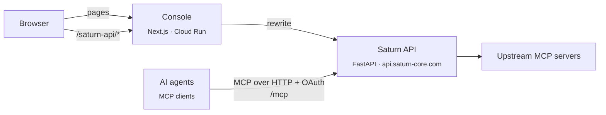

<div align="center">


# Saturn MCP Console

**The web console of Saturn MCP, the gateway between AI agents and their tools.**

Connect MCP servers, choose which tools each agent can see, write the policy that decides every call, approve what needs a person, and read the audit record, from one console.

[](LICENSE.md)
[](https://github.com/Saturn-Technology-Project/Saturn-MCP-Frontend/actions/workflows/check.yml)


[Features](#features) · [Quick start](#quick-start) · [Configuration](#configuration) · [Architecture](#architecture) · [Security](#security) · [Development](#development) · [中文](README_ZH.md)

</div>

---

## What it is

[Saturn MCP](https://saturn-core.com) sits between your AI agents and your MCP servers. Agents connect to one MCP endpoint and sign in with OAuth; Saturn holds the upstream credentials, shows each agent only the tools it is allowed to use, evaluates a policy on every call, holds sensitive calls for human approval, and records each step.

This repository is the console for it: a Next.js app that runs on Cloud Run at **[dashboard.saturn-core.com](https://dashboard.saturn-core.com)**. It holds no data of its own. Every request goes to the Saturn API, a FastAPI service in the separate [Saturn-MCP-Backend](https://github.com/Saturn-Technology-Project/Saturn-MCP-Backend) repository, served at `https://api.saturn-core.com`.

- **Free.** Every feature is on every account. If Saturn helps you, you can [sponsor the project on GitHub](https://github.com/sponsors/Saturn-Technology-Project).
- **Bilingual.** Every screen is in English and Traditional Chinese (Taiwan).
- **Usable by agents.** Every control has an accessible name, so computer-use agents can drive the console as well as people can ([details](#accessibility-and-computer-use)).

## Features

The sidebar, in order:

| Page | Route | What it does |
|---|---|---|
| ✅ **Approve** | `/approvals` | Tool calls a policy held for approval: agent, tool, arguments, triggered rule, risk, group progress and deadline. Approve or reject. Approval does not mean the tool has run; the execution state is shown separately. |
| 🔁 **Resubmit** | `/approvals/resubmit` | Approved calls waiting for the agent to send them again, with the time left before they expire. |
| 🏠 **Home** | `/overview` | Counts of agents, connected MCP servers, tool calls and pending approvals, tool usage, and recent activity. Refreshes every 10 seconds. |
| 🧩 **Marketplace** | `/tools` | A catalog of remote MCP servers from their publishers, by category. Connect one with the provider's OAuth sign-in in a pop-up window, or by pasting an access token; add any other server by URL. The token stays on Saturn. |
| 🔗 **Connections** | `/tools/connections` | The MCP servers this organization has connected: status, tools, usage, recent calls. Refresh the tool list, reconnect, replace the token, or remove a server. |
| 🤖 **Agents** | `/agents` | Agents that have connected to Saturn MCP, who registered them, and their tools. **Connect Agents** shows what to paste into an MCP client: the endpoint (`<API origin>/mcp`), HTTP transport, OAuth sign-in, the `saturn.mcp` scope and the `X-Saturn-Profile` header, plus a ready client config. |
| 🎛️ **Tools & Mapping** | `/tools/mapping` | Tool sets: which tools an agent on the set can discover, and whether each one runs or needs approval by default. Assign sets to agents. |
| 🛡️ **Policy** | `/policies` | Versioned runtime policies with IF / THEN rules on tool arguments (allow, require approval with per-group quorum, deny). Edit on a canvas, a form, or as JSON; generate a draft from a tool set with a template (Read Only, Balanced, Strict) while the model's progress streams in; ask the model to revise it; test a call against it; validate, review what it will allow, then activate. A deny in a policy overrides a set that allows the tool. |
| 📜 **Audit Logs** | `/activity` | The event chain of each call: requested, evaluated, approval, executed. Filter and export to JSON. Authorized members decrypt the stored request and response in the browser. |
| 🪝 **Webhooks** | `/webhooks` | HTTPS endpoints notified on `approval.granted`, `approval.rejected` and `approval.expired`, signed with HMAC-SHA256. Download or rotate the signing secret, send a test, see deliveries and retry them, and set the approval and resubmit windows (1 minute to 7 days). |

The account menu at the bottom of the sidebar:

| Page | Route | What it does |
|---|---|---|
| 👤 **Profile** | `/profile` | Name, photo, email change (a code to each address), password, light or dark theme, sign-in verification (email codes and passkeys), and which events Saturn emails you about. |
| 👥 **Team** | `/team` | Organization accounts only. Members, titles, and `none` / `read` / `write` permissions for agents, policies, approvals and team; emailed invites; approver groups. |
| 🏢 **Organization** | `/settings` | Organization name and logo, payload encryption (create the organization key, save its recovery key, unlock with it), and the member count. |
| 🌐 **Language** | | English or 繁體中文. Saved to your account. |
| ❤️ **Donate** | | Opens GitHub Sponsors. |

Outside the console: `/login` (password, then an email code, a passkey or an authenticator code), `/register` (a personal account or a team account where you are the admin), `/mfa` (passkey or authenticator setup; organization admins need one of the two), `/connect-passkey` (the passkey step when an agent's sign-in page on the API hands over to the console), `/accept-invite`, `/trust` (vulnerability disclosure; also `/.well-known/security.txt`) and `/healthz`.

## Quick start

Requires Node.js 22 (the version CI and the Docker image use) or Docker.

### Against the hosted API

```bash
git clone https://github.com/Saturn-Technology-Project/Saturn-MCP-Frontend.git
cd Saturn-MCP-Frontend
npm ci
npm run dev
```

Open [http://localhost:3000](http://localhost:3000). With no configuration the console talks to `https://api.saturn-core.com`, so you sign in with a Saturn account, or create one at `/register`.

The same thing in a production build, with Docker Compose:

```bash
docker compose up --build
```

[`docker-compose.yml`](docker-compose.yml) builds the [`Dockerfile`](Dockerfile) (a Next.js standalone server, run as an unprivileged user) and serves it on port `3000`. It is the console only; it points at the hosted API and starts no backend.

### Against a local API

Start the API from the [Saturn-MCP-Backend](https://github.com/Saturn-Technology-Project/Saturn-MCP-Backend) repository first (its `docker compose up --build` serves it on `http://localhost:8000`, with the admin account from `SEED_USER_EMAIL` and `SEED_USER_PASSWORD` in its `.env`). Then:

```bash
API_URL=http://localhost:8000 NEXT_PUBLIC_WS_URL=http://localhost:8000 npm run dev
```

Or put both variables in `.env.local` (see [`.env.example`](.env.example)). Restart `next dev` after changing `API_URL`: the rewrite is read once, when the config loads.

## Configuration

| Variable | Default | Purpose |
|---|---|---|
| `API_URL` | `https://api.saturn-core.com` | Where `/saturn-api/*` is forwarded. Read when `next.config.ts` loads, so a Docker image has it built in (`--build-arg API_URL=…`). |
| `NEXT_PUBLIC_WS_URL` | `https://api.saturn-core.com` | The API's public origin as the browser should see it. The console uses it only to show the MCP endpoint on the Agents page. Inlined at build time. `NEXT_PUBLIC_API_URL` is read if it is unset. |
| `ORIGIN_AUTH_SECRET` | unset | When set, every request except `/healthz` must carry this value in the origin header, or it gets `403`. On Cloud Run (`K_SERVICE` set) the console refuses every request until it is set. |
| `ORIGIN_AUTH_HEADER` | `x-saturn-origin-auth` | The header that carries the origin secret. |
| `ORIGIN_AUTH_SECRET_PREVIOUS` | unset | Also accepted, so the secret can be rotated without downtime. |
| `DOCKER_BUILD` | unset | `1` builds Next.js's `standalone` output. The Dockerfile sets it. |

`NEXT_PUBLIC_WS_URL` keeps its name from an earlier version, when the console opened WebSockets to the API. It no longer opens any; the value is only displayed.

[`next.config.ts`](next.config.ts) also sets a 600-second proxy timeout (policy generation waits on the model), the security headers listed under [Security](#security), and two redirects for old links: `/runs` to `/activity`, and `/agents/:id/runs/:runId` to `/activity?event=:runId`.

## Architecture



**One origin.** The browser calls only the console's own origin. `src/lib/api.ts` sends every API request to `/saturn-api/<path>`, and a Next.js rewrite forwards it to `API_URL`. Cookies are therefore first-party and there is no CORS to configure. Policy generation streams server-sent events through the same rewrite. The console opens no WebSocket. Agents never talk to the console; they call the API's `/mcp` endpoint directly.

**Client-rendered pages.** The root layout renders on every request so that each response gets its own CSP nonce (see below). The pages themselves are client components. `src/app/(console)/` holds everything behind sign-in; its layout wraps the pages in an auth gate that sends you to `/login?next=…` without a session, or to `/mfa` when an admin has neither a passkey nor an authenticator yet.

**State.**

- **Server data** goes through TanStack Query. One query (`["console"]`) loads the snapshot most pages share (agents, MCP servers, tool sets, approvals, activity) and refetches every 10 seconds and on window focus. Mutations invalidate it.
- **Client state** is two zustand stores: `auth-store` (the signed-in user and organization, persisted to `localStorage` as `saturn-auth`; the token is not persisted) and `locale-store` (`saturn-locale`).

**Languages.** [`src/lib/i18n/messages.ts`](src/lib/i18n/messages.ts) holds an `en` and a `zh` object. `zh` is typed from `en`, so a missing translation fails the type check. `useI18n()` returns `t("section.key", vars)`, which falls back to English and then to the key itself. The default is Traditional Chinese. Choosing a language updates `<html lang>` (`zh-Hant` or `en-US`) and, when signed in, saves it to the account (`PATCH /auth/locale`).

**UI.** Tailwind CSS 4 with shadcn components on Radix and Base UI, `next-themes` for the light and dark theme, and React Flow for the policy canvas.

| Path | Contents |
|---|---|
| `src/app/(console)/` | Pages behind sign-in |
| `src/app/{login,register,mfa,connect-passkey,accept-invite,trust,healthz}/` | Public pages and the health check |
| `src/components/` | UI by area: `layout`, `policies`, `tools`, `approvals`, `activity`, `account`, `settings`, `ui` |
| `src/lib/` | The API client (`api.ts`), i18n, password hashing (`password.ts`), payload encryption (`payload-crypto.ts`), the policy graph, the MCP catalog |
| `src/hooks/`, `src/stores/` | TanStack Query hooks and zustand stores |
| `src/proxy.ts` | Origin check and per-request CSP |

This version of Next.js renamed Middleware to Proxy, so request handling lives in `src/proxy.ts`. It has breaking changes from earlier versions; [`AGENTS.md`](AGENTS.md) points to the bundled docs in `node_modules/next/dist/docs/`.

## Security

How to report a vulnerability: email security@saturn-core.com ([`/.well-known/security.txt`](public/.well-known/security.txt)).

### Content Security Policy

[`src/proxy.ts`](src/proxy.ts) runs on every page request. It generates a random nonce, puts it in the request (`x-nonce`) and sets the `Content-Security-Policy` response header:

- `script-src 'self' 'nonce-…' 'strict-dynamic' 'wasm-unsafe-eval'`: only scripts carrying this response's nonce, and scripts they load. WebAssembly is allowed for Argon2id. Development adds `'unsafe-eval'`.
- `connect-src 'self'` and the hosted API (plus `localhost` in development).
- `object-src 'none'`, `frame-ancestors 'none'`, `frame-src 'none'`, `base-uri 'self'`, `form-action 'self'` and the hosted API (the passkey step of an agent's sign-in posts there), and `upgrade-insecure-requests` in production.

The root layout calls `connection()` so every page renders per request, which is how Next.js attaches the nonce to its own scripts, and it passes the nonce to the theme script that runs before hydration. Static assets under `_next/static`, `/saturn-api` and `logo.png` skip the proxy.

`next.config.ts` adds `X-Content-Type-Options: nosniff`, `X-Frame-Options: DENY`, `Referrer-Policy: no-referrer`, a `Permissions-Policy` that turns off camera, microphone, geolocation, payment, USB and motion sensors, and, in production, `Strict-Transport-Security`.

### Origin check

In production the Cloud Run service is reachable only through the front door. The proxy compares a secret header (`ORIGIN_AUTH_SECRET`, compared as SHA-256 digests in constant time) and answers `403` otherwise; `/healthz` is exempt so Cloud Run can probe it.

### Sessions

- **Passwords never leave the browser.** [`src/lib/password.ts`](src/lib/password.ts) runs Argon2id over the password, salted by the email, and splits the result with HKDF into a login verifier, which is all the API receives, and a wrap key that stays in the browser.
- **The session is an HttpOnly cookie** (`saturn_session`) set by the API. After sign-in the console holds the bearer token in memory only until the cookie is in place, and never writes it to storage.
- **Second factor.** After the password, sign-in asks for an email code, a passkey (WebAuthn) or, for accounts that have one, an authenticator code or backup code. Organization admins must set up a passkey or an authenticator before they reach the console, and an email code alone does not sign them in: after it they confirm with that passkey or authenticator.
- **Step-up.** Changing your email, turning off email codes or removing a passkey asks again for a password, an email code or a passkey when the API requires it. Changing the password asks for the current one.
- A `401` from the API clears the local session and returns to `/login`.

### Payload encryption

Stored audit payloads (tool arguments and upstream responses) are encrypted to the organization's key, which the API cannot open.

- The organization's ML-KEM-1024 key pair is generated in the browser. Its recovery key is shown once to download and is never uploaded.
- Each member's private key is wrapped with the Argon2id-derived wrap key above, and held in memory, not in browser storage, while you use the console.
- Raw payloads are decrypted in the browser when an authorized member opens an audit event.
- A member's new key must be approved by a team admin who checks its fingerprint, and a member who loses their password can be helped back to the records by another member; the console prompts for both.

## Accessibility and computer use

Every control in the console has an accessible role and name, taken from the same messages as its visible text, so screen readers and computer-use agents (a model driving a browser or the accessibility tree) can find "Approve", "Connect", a policy field or a tool set by name instead of by pixel:

- Inputs, selects and search boxes in the policy builder, groups, token fields and filters have labels. Icon-only buttons have `aria-label`.
- Rows in the Agents and Connections tables are buttons, so they work from the keyboard and report whether they are selected (`aria-pressed`). Toggles such as language and theme report their state the same way.
- Menus report `aria-expanded`, close with Escape, and the mobile sidebar is `inert` while it is closed.
- `<html lang>` follows the chosen language.

## Development

```bash
npm run dev     # Next.js dev server on port 3000
npm run build   # production build
npm run start   # serve the production build
npm run lint    # ESLint (eslint-config-next)
npx tsc --noEmit   # strict type check
```

`npm test` runs the unit tests with Node's own test runner: the proxy's allow-list, the password derivation (with known answers, so a library update cannot silently change it), key fingerprints, and the encryption and re-key flows with `fetch` replaced by a table of answers. There are no browser tests.

The [Check workflow](.github/workflows/check.yml) runs on every push to `main` and every pull request: a [gitleaks](https://github.com/gitleaks/gitleaks) secret scan, `npm ci`, an audit of production dependencies, lint, the type check, the tests and a production build. Dependabot updates npm packages, GitHub Actions and the Docker base image weekly.

Every user-visible string goes into both `en` and `zh` in `messages.ts`; give every new control an accessible name from those messages. `README.md` and `README_ZH.md` change together.

## Deploy

Pushing to `main` builds a `linux/amd64` image, pushes it to Artifact Registry and deploys that digest to Cloud Run on port `3000`, authenticating with Workload Identity Federation ([workflow](.github/workflows/deploy-cloud-run.yml)). The repository secrets and variables, and the order to deploy in (API first), are in [`DEPLOY.md`](DEPLOY.md).

## License

[FSL-1.1-ALv2](LICENSE.md). Copyright 2026 Rick Weng. You may read, audit, modify and self-host this code for any purpose except offering a competing commercial service. Two years after each version is released, it also becomes available under the Apache License 2.0.
