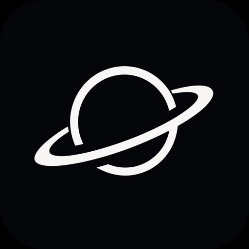
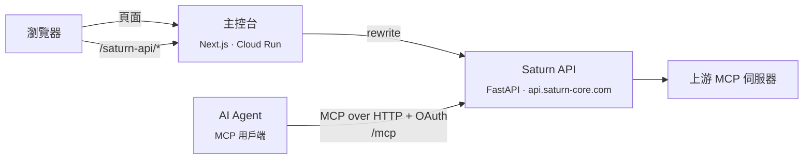

<div align="center">



# Saturn MCP Console

**Saturn MCP 的網頁主控台。Saturn MCP 是介於 AI Agent 與工具之間的 Gateway。**

在同一個主控台連接 MCP 伺服器、決定每個 Agent 看得到哪些工具、撰寫決定每一次呼叫的政策、核准需要人工確認的操作，並查閱稽核紀錄。

[](LICENSE.md)
[](https://github.com/Saturn-Technology-Project/Frontend/actions/workflows/check.yml)


[功能](#功能) · [快速開始](#快速開始) · [設定](#設定) · [架構](#架構) · [安全](#安全) · [開發](#開發) · [English](README.md)

</div>

---

## 這是什麼

[Saturn MCP](https://saturn-core.com) 位於你的 AI Agent 與 MCP 伺服器之間。Agent 只連到一個 MCP 端點，並以 OAuth 登入；Saturn 保管上游的憑證、只讓每個 Agent 看到它被允許使用的工具、對每一次呼叫評估政策、把敏感的呼叫留待人工核准，並記錄每一個步驟。

這個 repository 是它的主控台：一個在 Cloud Run 上執行的 Next.js 應用程式，網址是 **[dashboard.saturn-core.com](https://dashboard.saturn-core.com)**。主控台本身不保存任何資料，每個請求都送到 Saturn API。Saturn API 是獨立的 [Backend](https://github.com/Saturn-Technology-Project/Backend) repository 中的 FastAPI 服務，位於 `https://api.saturn-core.com`。

- **免費。** 每個帳號都能使用所有功能。如果 Saturn 對你有幫助，可以[在 GitHub 上贊助這個專案](https://github.com/sponsors/Saturn-Technology-Project)。
- **雙語。** 每個畫面都有英文與繁體中文（台灣）。
- **Agent 也能操作。** 每個控制項都有輔助使用名稱，電腦操作 Agent 可以跟人一樣操作主控台（[說明](#無障礙與電腦操作)）。

## 功能

側邊欄依序為：

| 頁面 | 路由 | 用途 |
|---|---|---|
| ✅ **核准** | `/approvals` | 被政策攔下、等待核准的工具呼叫：Agent、工具、參數、觸發的規則、風險、各群組的進度與期限。可以核准或拒絕。核准不代表工具已經執行；執行狀態另外顯示。 |
| 🔁 **重送** | `/approvals/resubmit` | 已核准、等待 Agent 再次送出的呼叫，以及到期前剩下的時間。 |
| 🏠 **首頁** | `/overview` | Agent、已連接的 MCP 伺服器、工具呼叫與待核准項目的數量，工具使用量，以及最近的活動。每 10 秒更新一次。 |
| 🧩 **市集** | `/tools` | 依分類列出各發行者提供的遠端 MCP 伺服器。可以在彈出視窗中以供應商的 OAuth 登入連接，或貼上 access token；其他伺服器可以用網址加入。Token 保存在 Saturn。 |
| 🔗 **連線** | `/tools/connections` | 這個組織已連接的 MCP 伺服器：狀態、工具、使用量、最近的呼叫。可以重新整理工具清單、重新連線、更換 token 或移除伺服器。 |
| 🤖 **Agent** | `/agents` | 已連到 Saturn MCP 的 Agent、註冊者，以及它們的工具。**Connect Agents** 會列出要貼進 MCP 用戶端的內容：端點（`<API 來源>/mcp`）、HTTP 傳輸、OAuth 登入、`saturn.mcp` scope 與 `X-Saturn-Profile` 標頭，並附上可直接使用的用戶端設定。 |
| 🎛️ **工具對應** | `/tools/mapping` | 工具集：使用這個集合的 Agent 可以找到哪些工具，以及每個工具預設直接執行或需要核准。可以把工具集指派給 Agent。 |
| 🛡️ **政策** | `/policies` | 有版本的執行期政策，以 IF / THEN 規則判斷工具參數（允許、需要核准並設定各群組的法定人數、拒絕）。可以在畫布、表單或 JSON 上編輯；以範本（Read Only、Balanced、Strict）從工具集產生草稿，並即時看到模型的進度；請模型修改草稿；用一次呼叫測試政策；驗證、檢查它會允許什麼，然後啟用。政策中的拒絕會蓋過工具集中的允許。 |
| 📜 **稽核紀錄** | `/activity` | 每次呼叫的事件鏈：請求、評估、核准、執行。可以篩選並匯出為 JSON。有權限的成員可以在瀏覽器中解密保存的請求與回應。 |
| 🪝 **Webhook** | `/webhooks` | 在 `approval.granted`、`approval.rejected` 與 `approval.expired` 時通知的 HTTPS 端點，以 HMAC-SHA256 簽章。可以下載或輪替簽章密鑰、送出測試、查看並重試傳送，以及設定核准與重送的期限（1 分鐘到 7 天）。 |

側邊欄底部的帳號選單：

| 頁面 | 路由 | 用途 |
|---|---|---|
| 👤 **個人資料** | `/profile` | 名稱、照片、變更電子郵件（兩個信箱各收一組驗證碼）、密碼、深淺模式、登入驗證（電子郵件驗證碼與通行金鑰），以及 Saturn 要寄信通知你的事件。 |
| 👥 **團隊** | `/team` | 僅限組織帳號。成員、職稱，以及對 Agent、政策、核准與團隊的 `none` / `read` / `write` 權限；以電子郵件寄送邀請；核准群組。 |
| 🏢 **組織** | `/settings` | 組織名稱與標誌、payload 加密（建立組織金鑰、保存復原金鑰、以復原金鑰解鎖），以及成員數。 |
| 🌐 **語言** | | English 或繁體中文，儲存在你的帳號。 |
| ❤️ **贊助** | | 開啟 GitHub Sponsors。 |

主控台以外的頁面：`/login`（先輸入密碼，再輸入電子郵件驗證碼、使用通行金鑰或輸入驗證器代碼）、`/register`（個人帳號，或由你擔任管理員的團隊帳號）、`/mfa`（設定驗證器，組織管理員必須完成）、`/accept-invite`、`/trust`（漏洞通報；另有 `/.well-known/security.txt`）與 `/healthz`。

## 快速開始

需要 Node.js 22（CI 與 Docker 映像檔使用的版本）或 Docker。

### 連到正式環境的 API

```bash
git clone https://github.com/Saturn-Technology-Project/Frontend.git
cd Frontend
npm ci
npm run dev
```

開啟 [http://localhost:3000](http://localhost:3000)。不做任何設定時，主控台會連到 `https://api.saturn-core.com`，所以要用 Saturn 帳號登入，或在 `/register` 建立帳號。

以 Docker Compose 執行正式建置版本：

```bash
docker compose up --build
```

[`docker-compose.yml`](docker-compose.yml) 會建置 [`Dockerfile`](Dockerfile)（Next.js standalone 伺服器，以非特權使用者執行），並在 `3000` 埠提供服務。它只包含主控台；指向正式環境的 API，不會啟動任何後端。

### 連到本機的 API

先從 Backend repository 啟動 API（它的 `docker compose up --build` 會在 `http://localhost:8000` 提供服務，管理員帳號來自其 `.env` 中的 `SEED_USER_EMAIL` 與 `SEED_USER_PASSWORD`）。接著：

```bash
API_URL=http://localhost:8000 NEXT_PUBLIC_WS_URL=http://localhost:8000 npm run dev
```

也可以把這兩個變數寫進 `.env.local`（見 [`.env.example`](.env.example)）。變更 `API_URL` 後要重新啟動 `next dev`：rewrite 只在載入設定時讀取一次。

## 設定

| 變數 | 預設值 | 用途 |
|---|---|---|
| `API_URL` | `https://api.saturn-core.com` | `/saturn-api/*` 要轉送到的位置。在載入 `next.config.ts` 時讀取，所以 Docker 映像檔會把它建置進去（`--build-arg API_URL=…`）。 |
| `NEXT_PUBLIC_WS_URL` | `https://api.saturn-core.com` | 瀏覽器看到的 API 公開來源。主控台只用它在 Agent 頁面顯示 MCP 端點。建置時內嵌。未設定時會讀取 `NEXT_PUBLIC_API_URL`。 |
| `ORIGIN_AUTH_SECRET` | 未設定 | 設定後，除了 `/healthz` 以外的每個請求都必須在來源標頭中帶上這個值，否則回傳 `403`。在 Cloud Run 上（有設定 `K_SERVICE`），未設定這個值時主控台會拒絕所有請求。 |
| `ORIGIN_AUTH_HEADER` | `x-saturn-origin-auth` | 攜帶來源密鑰的標頭。 |
| `ORIGIN_AUTH_SECRET_PREVIOUS` | 未設定 | 同樣接受，讓密鑰可以在不中斷服務的情況下輪替。 |
| `DOCKER_BUILD` | 未設定 | `1` 會建置 Next.js 的 `standalone` 輸出。Dockerfile 會設定它。 |

`NEXT_PUBLIC_WS_URL` 沿用舊版的名稱，當時主控台會對 API 開啟 WebSocket。現在主控台不開啟任何 WebSocket，這個值只用於顯示。

[`next.config.ts`](next.config.ts) 另外設定了 600 秒的 proxy 逾時（產生政策要等模型回應）、[安全](#安全)一節列出的安全標頭，以及兩個給舊連結的轉址：`/runs` 轉到 `/activity`，`/agents/:id/runs/:runId` 轉到 `/activity?event=:runId`。

## 架構



**單一來源。** 瀏覽器只呼叫主控台自己的來源。`src/lib/api.ts` 把每個 API 請求送到 `/saturn-api/<path>`，再由 Next.js rewrite 轉送到 `API_URL`。因此 cookie 都是第一方 cookie，也不需要設定 CORS。產生政策時的 server-sent events 也走同一個 rewrite。主控台不開啟任何 WebSocket。Agent 從不與主控台通訊，而是直接呼叫 API 的 `/mcp` 端點。

**在用戶端繪製的頁面。** 根 layout 在每個請求時繪製，讓每個回應都有自己的 CSP nonce（見下文）。頁面本身是 client component。`src/app/(console)/` 包含所有需要登入的頁面；它的 layout 以驗證關卡包住頁面：沒有 session 時導向 `/login?next=…`，管理員尚未設定驗證器時導向 `/mfa`。

**狀態。**

- **伺服器資料**透過 TanStack Query 取得。一個查詢（`["console"]`）載入多數頁面共用的快照（Agent、MCP 伺服器、工具集、核准、活動），每 10 秒以及視窗取得焦點時重新取得。變更操作完成後會讓它失效。
- **用戶端狀態**是兩個 zustand store：`auth-store`（登入的使用者與組織，以 `saturn-auth` 保存在 `localStorage`；不保存 token）與 `locale-store`（`saturn-locale`）。

**語言。** [`src/lib/i18n/messages.ts`](src/lib/i18n/messages.ts) 包含 `en` 與 `zh` 兩個物件。`zh` 的型別由 `en` 推導，缺少翻譯時型別檢查會失敗。`useI18n()` 回傳 `t("section.key", vars)`，找不到時先退回英文，再退回 key 本身。預設語言是繁體中文。選擇語言會更新 `<html lang>`（`zh-Hant` 或 `en-US`），登入時也會儲存到帳號（`PATCH /auth/locale`）。

**介面。** Tailwind CSS 4，shadcn 元件建立在 Radix 與 Base UI 上，以 `next-themes` 切換深淺模式，政策畫布使用 React Flow。

| 路徑 | 內容 |
|---|---|
| `src/app/(console)/` | 需要登入的頁面 |
| `src/app/{login,register,mfa,accept-invite,trust,healthz}/` | 公開頁面與健康檢查 |
| `src/components/` | 依領域分類的介面：`layout`、`policies`、`tools`、`approvals`、`activity`、`account`、`settings`、`ui` |
| `src/lib/` | API 用戶端（`api.ts`）、i18n、密碼雜湊（`password.ts`）、payload 加密（`payload-crypto.ts`）、政策圖、MCP 目錄 |
| `src/hooks/`、`src/stores/` | TanStack Query hook 與 zustand store |
| `src/proxy.ts` | 來源檢查與每個請求的 CSP |

這個版本的 Next.js 把 Middleware 改名為 Proxy，所以請求處理寫在 `src/proxy.ts`。它與舊版有不相容的變更；[`AGENTS.md`](AGENTS.md) 指向 `node_modules/next/dist/docs/` 中隨套件附帶的文件。

## 安全

通報漏洞：寄信到 security@saturn-core.com（[`/.well-known/security.txt`](public/.well-known/security.txt)）。

### 內容安全政策（CSP）

[`src/proxy.ts`](src/proxy.ts) 在每個頁面請求時執行。它產生一個隨機 nonce，放進請求（`x-nonce`），並設定 `Content-Security-Policy` 回應標頭：

- `script-src 'self' 'nonce-…' 'strict-dynamic' 'wasm-unsafe-eval'`：只執行帶有這個回應 nonce 的腳本，以及它們載入的腳本。允許 WebAssembly 是為了 Argon2id。開發模式另外加上 `'unsafe-eval'`。
- `connect-src 'self'` 與正式環境的 API（開發模式另加 `localhost`）。
- `object-src 'none'`、`frame-ancestors 'none'`、`frame-src 'none'`、`base-uri 'self'`、`form-action 'self'`，正式環境另加 `upgrade-insecure-requests`。

根 layout 呼叫 `connection()`，讓每個頁面都在請求時繪製，Next.js 才能把 nonce 加到自己的腳本上；它也把 nonce 交給在 hydration 前執行的主題腳本。`_next/static` 下的靜態檔案、`/saturn-api` 與 `logo.png` 不經過 proxy。

`next.config.ts` 另外加上 `X-Content-Type-Options: nosniff`、`X-Frame-Options: DENY`、`Referrer-Policy: no-referrer`、關閉相機、麥克風、定位、付款、USB 與動作感測器的 `Permissions-Policy`，正式環境另加 `Strict-Transport-Security`。

### 來源檢查

在正式環境中，Cloud Run 服務只能經由前端入口存取。Proxy 會比對一個密鑰標頭（`ORIGIN_AUTH_SECRET`，以 SHA-256 摘要做固定時間比較），不符合時回傳 `403`；`/healthz` 不受限制，讓 Cloud Run 可以探測。

### Session

- **密碼不會離開瀏覽器。** [`src/lib/password.ts`](src/lib/password.ts) 以電子郵件為 salt 對密碼執行 Argon2id，再以 HKDF 拆成登入驗證值（API 只會收到這個）與留在瀏覽器中的包裝金鑰。
- **Session 是 API 設定的 HttpOnly cookie**（`saturn_session`）。登入後，主控台只在 cookie 設定完成前把 bearer token 暫存在記憶體中，從不寫入儲存空間。
- **第二因素。** 輸入密碼後，登入會要求電子郵件驗證碼、通行金鑰（WebAuthn），或是對已設定驗證器的帳號要求驗證器代碼或備用碼。組織管理員必須先設定驗證器才能進入主控台。
- **再次驗證。** API 要求時，變更電子郵件、關閉電子郵件驗證碼或移除通行金鑰前，需要再次輸入密碼、電子郵件驗證碼或使用通行金鑰。變更密碼時需要輸入目前的密碼。
- API 回傳 `401` 時，會清除本機 session 並回到 `/login`。

### Payload 加密

保存的稽核 payload（工具參數與上游回應）以組織的金鑰加密，API 無法解開。

- 組織的 ML-KEM-1024 金鑰對在瀏覽器中產生。它的復原金鑰只顯示一次供下載，從不上傳。
- 每位成員的私鑰以上述由 Argon2id 推導出的包裝金鑰加密；使用主控台期間保存在記憶體中，不寫入瀏覽器儲存空間。
- 有權限的成員開啟稽核事件時，原始 payload 在瀏覽器中解密。
- 成員的新金鑰必須由團隊管理員核對指紋後核准；忘記密碼的成員可以由另一位成員協助重新取得紀錄。主控台會為這兩種情況顯示提示。

## 無障礙與電腦操作

主控台中每個控制項都有輔助使用角色與名稱，取自與可見文字相同的訊息，因此螢幕閱讀器與電腦操作 Agent（透過瀏覽器或輔助使用樹操作的模型）可以依名稱找到「核准」、「連接」、某個政策欄位或工具集，而不是靠像素：

- 政策編輯器、群組、token 欄位與篩選器中的輸入框、下拉選單與搜尋框都有標籤。只有圖示的按鈕都有 `aria-label`。
- Agent 與連線表格中的每一列都是按鈕，可以用鍵盤操作，並回報是否被選取（`aria-pressed`）。語言與深淺模式等切換也以同樣方式回報狀態。
- 選單會回報 `aria-expanded`，按 Escape 關閉；行動版側邊欄關閉時為 `inert`。
- `<html lang>` 跟隨所選的語言。

## 開發

```bash
npm run dev     # Next.js 開發伺服器，3000 埠
npm run build   # 正式建置
npm run start   # 執行正式建置
npm run lint    # ESLint（eslint-config-next）
npx tsc --noEmit   # 嚴格型別檢查
```

目前還沒有自動化測試。[Check workflow](.github/workflows/check.yml) 在每次推送到 `main` 與每個 pull request 時執行：[gitleaks](https://github.com/gitleaks/gitleaks) 秘密掃描、`npm ci` 與型別檢查。Dependabot 每週更新 npm 套件與 GitHub Actions。

每個使用者看得到的字串都要同時加進 `messages.ts` 的 `en` 與 `zh`；每個新的控制項都要以這些訊息提供輔助使用名稱。`README.md` 與 `README_ZH.md` 一起修改。

## 部署

推送到 `main` 時會建置 `linux/amd64` 映像檔、推送到 Artifact Registry，並以 Workload Identity Federation 驗證，把該映像檔摘要部署到 Cloud Run 的 `3000` 埠（[workflow](.github/workflows/deploy-cloud-run.yml)）。Repository 的 secrets 與變數，以及部署順序（先部署 API），見 [`DEPLOY.md`](DEPLOY.md)。

## 授權

[FSL-1.1-ALv2](LICENSE.md)。Copyright 2026 Rick Weng。你可以為任何目的閱讀、稽核、修改並自行架設這份程式碼，但不得用來提供與其競爭的商業服務。每個版本發布滿兩年後，也會以 Apache License 2.0 授權。
